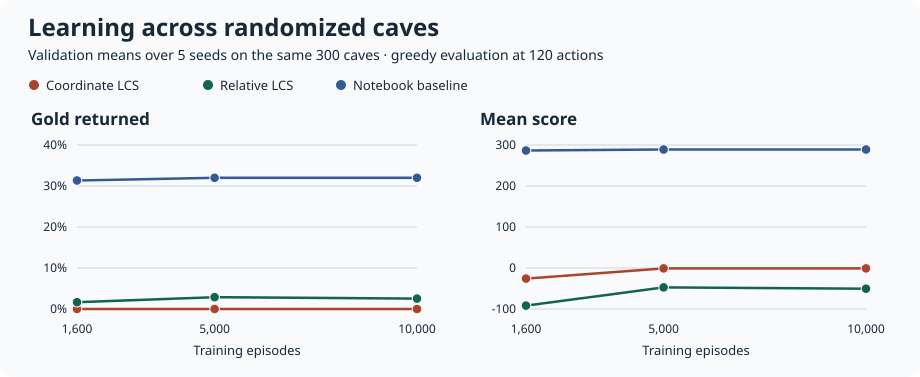

# Randomized-cave LCS: results

**Randomized training solved the missing-rule problem on the test set, but not the navigation problem.** The coordinate-based LCS learned to leave immediately. Relative, memory-derived inputs enabled some gold returns, but the agent often got stuck repeating actions. The notebook baseline remained well ahead.

For each of five seeds, the randomized policies saw the same training layouts. Each frozen policy was evaluated on the same 500 fresh caves with a 120-action cap. Training episodes were capped at 100 actions. The two randomized LCS variants used the same covering, strength updates, and action set; only their inputs differed. The fixed-map reference was trained for 1,500 episodes on the lab map, as in Issue #5.

| Policy | Mean score | Gold | Deaths | Retreats | Timeouts | No rule |
|---|---:|---:|---:|---:|---:|---:|
| Fixed-map LCS reference | −465.8 | 3 | 235 | 0 | 0 | 262 |
| Randomized LCS, coordinates | −1.0 | 0 | 0 | 500 | 0 | 0 |
| Randomized LCS, relative inputs | −55.8 | 11.2 | 0 | 168.0 | 320.8 | 0 |
| Randomized notebook baseline | 326.9 | 178 | 9 | 313 | 0 | 0 |

Counts are means per 500-cave run over five seeds, so they can be fractional. The relative LCS returned gold in **2.24%** of runs, with **0–16** returns per seed. The notebook returned gold in **35.6%**. In the original Issue #5 test set, randomized coordinate training likewise eliminated no-match stops but replaced them with immediate retreats.

## Does more training or more time help?

The main run stopped at **10,000 episodes**. From 5,000 to 10,000, the relative LCS’s validation gold rate fell from **2.9% to 2.5%** and its mean score fell from **−47.2 to −50.4**. The coordinate LCS stayed at zero gold. Neither met the threshold to extend training. Giving the relative agent **240 instead of 120 actions** added no gold exits on validation; it only increased the costs of timeouts.

[Fresh test cave 1](traces.json) shows why: the coordinate LCS exited on action one, the relative LCS moved once and then tried `climb` **119 times** away from the entrance, and the notebook agent returned gold in 17 actions. On cave 8, the relative LCS did successfully grab adjacent gold and navigate back to the entrance.

## Follow-up: block `climb` away from the entrance

A separate paired test retrained the relative LCS with and without this one action restriction, on another split. It reached **25,000 episodes** because the unguarded control improved enough on validation from 5,000 to 10,000; neither version qualified for 50,000. On the independent 500-cave test, blocking the no-op **reduced** gold exits from **15.8 to 3.4 per seed** and lowered the mean score from **−44.4 to −72.8**. Some traces still looped by alternating left and right turns. Removing one ineffective command did not solve navigation.

**Next step:** test whether distinguishing *visited* from *unvisited* safe squares helps the LCS make progress. That addresses a different failure mode than longer episodes or a single blocked action.

[Configuration](config.json) · [Validation curve data](validation-curve.csv) · [Per-cave results](test-episodes.csv) · [120 vs. 240 actions](horizon-validation.csv) · [Separate climb-guard results](../issue-2-climb/test-summary.csv)
