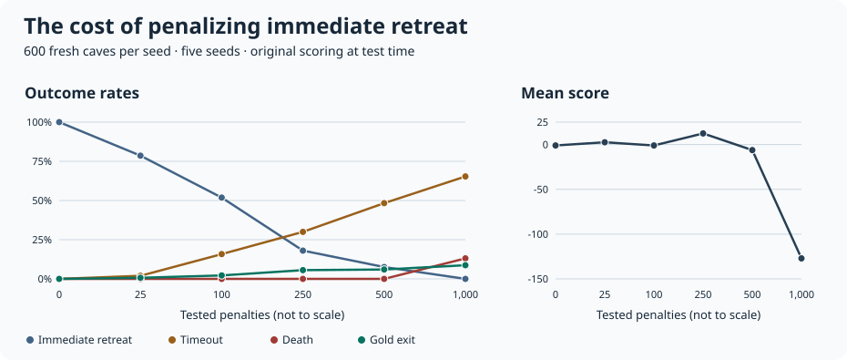

# Primitive navigation and strategy: follow-up

**The best LCS returned gold on 18.7% of fresh randomized caves, up from 0% for exact covering.** It still chose every primitive command directly. No route planner, inferred hazard labels, action mask, expert path, or hidden map was passed to the agent.

The best variant combines partial-match rules, a 12-step credit update, replay of the agent's own successful experiences, a short curriculum, and a wider view of raw observations it had actually made. Matching rules share action credit rather than treating every exact memory record as a new state. The same six commands remain available, and the best variant uses **no reward penalty or novelty bonus**.

## Held-out confirmation

Five seeds were tested on the same **600 fresh caves** after 5,000 training episodes. The notebook baseline uses its planner. No evaluation run learns, replays, or sees shaped rewards.

| Policy | Gold exits | Gold exits on non-adjacent maps | Mean score |
|---|---:|---:|---:|
| Original exact-covering LCS | 0% | 0% | −4.2 |
| Shared rules, no replay or shaping | 0% | 0% | −1.0 |
| Shared rules, −25 early-retreat penalty | 0% | 0% | −1.0 |
| Shared rules, −100 early-retreat penalty | 4.8% | 1.1% | +31.7 |
| Self-replay, local observations | 14.6% | 7.8% | +72.3 |
| **Self-replay, wider raw observations** | **18.7%** | **10.7%** | **+108.1** |
| Notebook with planner | 32.5% | 26.4% | +283.5 |

“Non-adjacent” means the gold is at least two Manhattan moves from the entrance; there are 519 such layouts. The best LCS succeeded in every seed. It exited with the gold on **561 of 574** runs in which it picked it up (97.7%), but **39.6%** of all its runs still timed out. Finding the gold consistently, without getting stuck, remains the main limitation on this test.

One [held-out trace](final/traces.json) reaches gold at `(4,4)` and returns in **27 commands**, scoring **963**. This demonstrates a learned trip beyond the adjacent square across an unseen layout. It does not show that the policy learns the equivalent of a general-purpose pathfinder or solves most random caves.

## Does penalizing early retreat as much as death help?

**It prevents immediate retreat, but hurts the original objective.** Training with a −1,000 surcharge makes an empty exit before leaving the entrance worth −1,001, exactly like a fatal move. The surcharge does not apply in testing. This sweep used another 600 fresh caves and otherwise matched the learner, training layouts, and budget within each pair.

| Training penalty | Immediate retreat | Gold | Death | Timeout | Mean original score |
|---|---:|---:|---:|---:|---:|
| 0 | 100.0% | 0.0% | 0.0% | 0.0% | −1.0 |
| −25 | 78.6% | 0.7% | 0.0% | 2.0% | +2.6 |
| −100 | 51.9% | 2.2% | 0.0% | 15.8% | −1.0 |
| −250 | 18.0% | 5.6% | 0.0% | 30.0% | +12.4 |
| −500 | 7.5% | 6.0% | 0.0% | 48.3% | −6.2 |
| −1,000 | 0.0% | 8.7% | 13.1% | 65.4% | −127.1 |

Even the stronger replay policy scored worse with the death-sized penalty on the paired split: gold rose slightly (**14.3% → 15.0%**) while deaths rose (**4.4% → 16.9%**), timeouts rose (**37.5% → 63.5%**), and mean score fell (**+46.3 → −104.3**). The penalty rewarded avoiding surrender, not necessarily finding and returning the gold. The stronger unshaped policy is the better baseline for further work.

[Penalty sweep results](penalty-dose/test-summary.csv) · [Penalty per-cave outcomes](penalty-dose/test-episodes.csv)

[All hypotheses and validation outcomes](experiment-log.md) · [Per-seed results](final/test-summary.csv) · [Per-cave outcomes](final/test-episodes.csv) · [Traces](final/traces.json)
