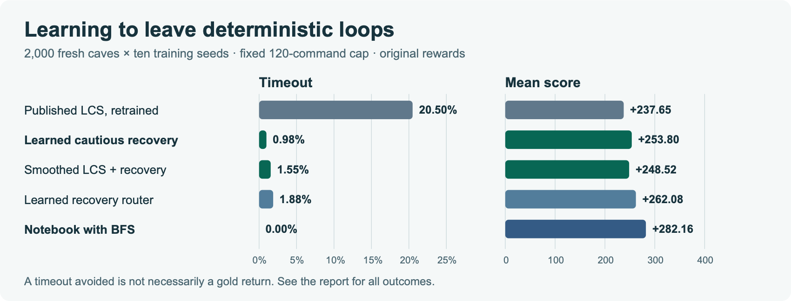
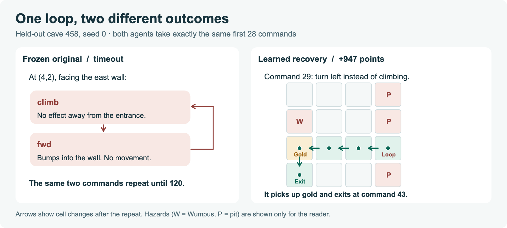

# Learning to recover from Wumpus World timeouts

**The cautious recovery LCS cut timeouts from 20.50% to 0.98% on 2,000
unseen caves and ten training seeds.** It returned slightly more gold and
earned **16.14 more points per run** than the same LCS without recovery.
Deaths increased by **0.04 percentage points**. The notebook with a
planner still had zero timeouts and the highest mean score.

## 1. What the timeouts were

I reproduced every published outcome and inspected all **1,793** historical
timeouts. Every one repeated the entire simulator state and policy memory:
the deterministic policy therefore had no way to break the cycle by
waiting. **59.6%** moved among multiple cells, and only **two** were
the same `climb` command outside the entrance. The median cycle had eight
commands and began at command 27. **1,770** timeouts were before pickup;
none of them had seen glitter. Navigation during exploration, not
bringing gold home after pickup, was the main cause.

[Audit summary](diagnosis/summary.json) · [Per-timeout evidence](diagnosis/timeouts.csv)

## 2. What reduced the timeouts

Keep the original rule table frozen. When the agent itself sees an exact
repeat of its observed state and memory, activate a second learned table.
It scores all six commands and samples more broadly from its learned
scores when it revisits the same state. It does not compute a route,
remove actions, or inspect the actual hazard map. Extra death and cap
costs train the cautious table, but the test uses the **original score and
120-command cap**.

| Frozen policy | Timeouts | Gold returned | Deaths | Mean score |
|---|---:|---:|---:|---:|
| Published LCS, retrained for this split | 20.50% | 30.88% | 3.44% | +237.65 |
| **Cautious learned recovery** | **0.98%** | **31.07%** | **3.48%** | **+253.80** |
| Smoothed-target LCS without recovery | 17.68% | 30.61% | 3.79% | +234.55 |
| Smoothed-target LCS with recovery | 1.55% | 30.91% | 3.83% | +248.52 |
| Learned recovery router (corrected rerun) | 1.88% | 32.25% | 3.72% | +262.08 |
| Notebook with BFS | 0.00% | 31.30% | 2.00% | +282.16 |

Cautious recovery left all **15,901** already-terminating baseline outcomes
unchanged. Of **4,099** baseline timeouts, **3,857** became empty exits,
**38** became gold returns, **8** became deaths, and **196** remained.
The point estimates satisfy the locked validation guardrails on gold,
score, and death. The paired 95% intervals versus the baseline are:

| Metric | Difference | Paired 95% interval |
|---|---:|---:|
| Timeout rate | −19.52 pp | [−22.74, −16.69] pp |
| Gold-return rate | +0.19 pp | [+0.06, +0.35] pp |
| Death rate | +0.04 pp | [0.00, +0.11] pp |
| Mean original score | +16.14 | [+13.03, +19.62] |

The result is near zero **on average**, not a guarantee. The worst seed
still timed out in 2.50% of runs. All 196 remaining timeouts triggered
recovery; 186 had not visited a new cell in at least 30 commands, and
18 had picked up gold. These are stalls under a stochastic policy,
not automatically the same certified infinite cycles.

**Example:** on cave 458 (seed 0), the original LCS repeated `climb`,
`fwd` at a wall. Both policies ran the same first 28 commands. At command
29 the recovery model chose `turn_l` instead; it later picked up gold
at `(1,2)` and climbed out after **43 commands for +947**.
[Both command sequences are recorded.](final/traces.json)

## 3. What would it take to beat the notebook?

The learned router picks one of two full recovery tables based on the
predicted score gain and additional risk. It gained **8.28 points**
(95% interval **[+4.27, +13.07]**) over cautious recovery, trading about
one extra percentage point of timeouts for more gold. Its gold rate was
**0.95 percentage points** above the notebook's in this sample, but the
paired interval **[−0.99, +2.71] pp** includes zero. Its score remained
**20.08 points lower** (95% interval **[−37.87, −2.26]**). It did not
beat the planner.

The gap has a concrete breakdown: per run, the router gained **9.45**
points from extra gold, but lost **17.20** to more deaths, **8.74** to
more commands, and **3.60** to more arrows. The near-zero-timeout policy
is the better default; the router shows where a future improvement might
come from. An exact-repeat gate cannot undo deaths that occur before a
loop: it preserves all 687 baseline deaths. First calibrate a separate
death predictor for the backbone as well as for recovery and constrain
its increase during exploration. Then compare coherent exploration
(one exploratory policy per episode) and a small recurrent,
planner-free agent with equal simulator-action budgets. The
[experiment log](experiment-log.md#prioritized-next-tests-informed-by-the-literature)
links the literature and distinguishes implemented ablations from proposals.

## Reproducibility

- [Locked selection](selection.md): models and readout settings were
  chosen on 600 validation layouts. Neither those layouts nor the
  earlier audit caves were used as the final panel. Seeds 5–9 were
  also absent from validation. Confidence intervals resample both
  seed and cave axes, keeping policies paired. Differences are computed
  before rounding.
- [Primary episodes and corrected router](final-corrected/episodes.csv),
  [paired cautious results](final/cautious-paired.json),
  [paired corrected router results](final-corrected/router-paired.json),
  [smoothed ablation](final-smooth/paired-outcomes.json).
- Independent retraining reproduced all 16,000 locked evaluation rows
  for seeds 0 and 9. The post-audit correction of the router prefix
  reproduced all 60,000 non-router rows unchanged. Its gain was measured
  on a **same-panel rerun with no retuning**, not a second independent test.
  The code passes 46 local tests.
- Average training actions per seed: **1.35M** baseline, **1.69M**
  cautious, **2.54M** router, **0.17M** notebook. The test budget and reward
  match; training budgets do not.
